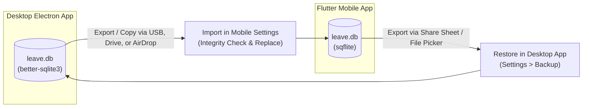

# Spec: Flutter Mobile Replica of LeaveDesk

## 1. Objective

Build an offline-first cross-platform mobile application (Android & iOS, phones and tablets) using **Flutter** that replicates the complete functionality of the desktop **LeaveDesk** (Civil Service Leave Management System for the Provincial Government of Maguindanao del Norte).

The Flutter application must achieve **100% binary database interoperability** with the desktop Electron application by reading and writing the exact same SQLite `leave.db` database schema without schema mismatches, migrations, or intermediate conversion layers. It must implement the official Civil Service Commission (CSC) leave accrual and deduction formulas, support offline CRUD for all entities, and generate official CSC Form No. 6 and Employee Leave Card PDFs for sharing and archiving.

---

## 2. Tech Stack

| Layer | Technology | Selection Rationale |
|---|---|---|
| **Framework** | Flutter 3.x (Dart 3.x) | Native performance on Android & iOS with responsive layout for phone & tablet. |
| **Target OS / Minimums** | Android 8.0+ (API 26) / iOS 14.0+ | Modern Scrypt crypto, stable Storage Access Framework for `.db` file interchange, modern permission model. |
| **Local Database** | `sqflite` (Android/iOS) + `sqflite_common_ffi` (Desktop/testing) | Raw SQLite engine compatible with desktop `better-sqlite3` and raw `.db` files. |
| **State Management** | `flutter_riverpod` (v2.x) | Compile-safe dependency injection, `AsyncValue` data caching, and decoupled provider invalidation on database switch. |
| **PDF Generation** | `pdf` (v3.11+) | Precise canvas and table rendering for CSC Form No. 6 and Leave Card ledgers. |
| **File Sharing & Storage** | `file_picker` & `share_plus` & `path_provider` | Exporting, importing, and sharing `leave.db` and generated PDF files. |
| **Calendar Widget** | `table_calendar` | Visual leave event rendering and day selection matching desktop FullCalendar. |
| **Security / Crypto** | `cryptography` or `pointycastle` | Scrypt password hashing matching desktop PIN verification (`9696`). |

---

## 3. Commands

```bash
# Get dependencies
flutter pub get

# Run on connected device or simulator
flutter run

# Run unit and widget tests
flutter test

# Run tests with coverage
flutter test --coverage

# Build Android APK (Release)
flutter build apk --release

# Build Android App Bundle (Google Play)
flutter build appbundle --release

# Build iOS Application (Release)
flutter build ipa --release
```

---

## 4. Project Structure

```
leave_desk_mobile/
├── lib/
│   ├── main.dart                      # App entry point, ProviderScope initialization
│   ├── app.dart                       # MaterialApp.router, theme configuration
│   ├── core/
│   │   ├── constants/                 # Colors, typography, CSC leave constants
│   │   ├── database/
│   │   │   ├── database_helper.dart   # SQLite connection, pragmas, table creation, migrations
│   │   │   └── database_transfer.dart # Export .db, import .db, backup verification
│   │   ├── rules/
│   │   │   ├── leave_rules.dart       # Pure Dart calculation engine (accrual, carry-over, weekdays)
│   │   │   └── pin_validator.dart     # Scrypt PIN authentication matching desktop
│   │   └── utils/
│   │       ├── date_formatters.dart   # ISO YYYY-MM-DD parsing, display formatters
│   │       └── dialogs.dart           # Reusable confirmation and PIN prompt dialogs
│   ├── models/
│   │   ├── employee.dart              # Employee entity & JSON/SQLite mappers
│   │   ├── leave_type.dart            # LeaveType entity
│   │   ├── leave.dart                 # Leave application entity & LeaveRow join model
│   │   ├── balance.dart               # Calculated employee leave balance model
│   │   ├── signatory.dart             # Signatory entity (Governor, HRMO, Supervisors)
│   │   └── audit_log.dart             # AuditLog entity
│   ├── repositories/                  # SQLite query layers (mirrors desktop db.ts handlers)
│   │   ├── employee_repository.dart
│   │   ├── leave_repository.dart
│   │   ├── balance_repository.dart
│   │   ├── signatory_repository.dart
│   │   └── audit_repository.dart
│   ├── services/
│   │   └── pdf/
│   │       ├── csc_form6_pdf.dart     # Official CSC Form No. 6 PDF builder
│   │       └── leave_card_pdf.dart    # Civil Service Leave Card Ledger PDF builder
│   └── features/                      # UI modules (Screens, Providers, Widgets)
│       ├── navigation/                # Responsive navigation (Drawer on phone, Rail on tablet)
│       ├── dashboard/                 # Metric cards, pending counter, upcoming leaves
│       ├── employees/                 # Employee list, search, filter, edit modal, balance setup
│       ├── leave/                     # Leave list, status filters, apply modal, validation checks
│       ├── calendar/                  # Monthly visual calendar, day detail modal
│       ├── reports/                   # Ledger summary table, year selector, export triggers
│       ├── logs/                      # Audit trail table, authorized PIN clear action
│       └── settings/                  # Leave types, signatories, database export/import
├── assets/
│   ├── images/
│   │   ├── maguindanao_del_norte.jpg  # Official provincial seal
│   │   └── bangsamoro.png             # BARMM official seal
│   └── icons/
├── test/
│   ├── unit/
│   │   ├── leave_rules_test.dart      # Verifies 1.25 accrual, carry-over, weekday formulas
│   │   └── pin_validator_test.dart    # Verifies Scrypt matching desktop salt & iterations
│   └── integration/
│       └── database_interop_test.dart # Verifies opening and reading actual desktop leave.db
└── pubspec.yaml
```

---

## 5. Complete SQLite Database Specification

The database **must** be stored as standard SQLite (filename: `leave.db`). The schema must exactly match the desktop SQLite schema:

### 5.1 Connection PRAGMAs
```sql
PRAGMA journal_mode = WAL;
PRAGMA foreign_keys = ON;
```

### 5.2 DDL Schema
```sql
CREATE TABLE IF NOT EXISTS employees (
  id INTEGER PRIMARY KEY AUTOINCREMENT,
  name TEXT NOT NULL,
  position TEXT NOT NULL DEFAULT '',
  department TEXT NOT NULL DEFAULT '',
  hire_date TEXT NOT NULL,
  active INTEGER NOT NULL DEFAULT 1
);

CREATE TABLE IF NOT EXISTS leave_types (
  id INTEGER PRIMARY KEY AUTOINCREMENT,
  name TEXT NOT NULL UNIQUE,
  annual_days REAL NOT NULL CHECK (annual_days >= 0),
  accrues_monthly INTEGER NOT NULL DEFAULT 1,
  carry_over_cap REAL NOT NULL DEFAULT 0 CHECK (carry_over_cap >= 0),
  prorate_new_hires INTEGER NOT NULL DEFAULT 1
);

CREATE TABLE IF NOT EXISTS leaves (
  id INTEGER PRIMARY KEY AUTOINCREMENT,
  employee_id INTEGER NOT NULL REFERENCES employees(id),
  leave_type_id INTEGER NOT NULL REFERENCES leave_types(id),
  sub_type TEXT,
  start_date TEXT NOT NULL,
  end_date TEXT NOT NULL,
  days INTEGER NOT NULL,
  status TEXT NOT NULL CHECK (status IN ('pending','approved','rejected','cancelled')),
  reason TEXT NOT NULL DEFAULT '',
  created_at TEXT NOT NULL DEFAULT (datetime('now','localtime'))
);

CREATE TABLE IF NOT EXISTS starting_balances (
  employee_id INTEGER NOT NULL REFERENCES employees(id) ON DELETE CASCADE,
  leave_type_id INTEGER NOT NULL REFERENCES leave_types(id) ON DELETE CASCADE,
  days REAL NOT NULL DEFAULT 0,
  PRIMARY KEY (employee_id, leave_type_id)
);

CREATE TABLE IF NOT EXISTS audit_logs (
  id INTEGER PRIMARY KEY AUTOINCREMENT,
  action TEXT NOT NULL,
  details TEXT NOT NULL,
  created_at TEXT NOT NULL DEFAULT (datetime('now','localtime'))
);

CREATE TABLE IF NOT EXISTS signatories (
  id INTEGER PRIMARY KEY AUTOINCREMENT,
  name TEXT NOT NULL DEFAULT '',
  position TEXT NOT NULL DEFAULT '',
  office TEXT NOT NULL DEFAULT '',
  role TEXT NOT NULL DEFAULT 'supervisor'
);

CREATE TABLE IF NOT EXISTS settings (
  key TEXT PRIMARY KEY,
  value TEXT NOT NULL
);

-- Performance Indexes
CREATE INDEX IF NOT EXISTS idx_leaves_emp_type ON leaves (employee_id, leave_type_id, status);
CREATE INDEX IF NOT EXISTS idx_leaves_dates ON leaves (start_date, end_date);
```

### 5.3 Default Seed Data
1. **Leave Types:**
   - `Vacation Leave`: `annual_days = 15`, `accrues_monthly = 1`, `carry_over_cap = 100`, `prorate_new_hires = 1`
   - `Sick Leave`: `annual_days = 15`, `accrues_monthly = 1`, `carry_over_cap = 100`, `prorate_new_hires = 1`

2. **Default PIN Hash:**
   - Salt: `'leave_salt'`
   - Default PIN: `'9696'`
   - Hash Algorithm: `scrypt` (N=16384, r=8, p=1, keyLen=32) stored in `settings` with key `'pin_hash'`.

3. **Vacation Leave Sub-Types:**
   - `Vacation Leave`, `Mandatory/Forced Leave`, `Maternity Leave`, `Paternity Leave`, `Special Privilege Leave`, `Solo Parent Leave`, `Study Leave`, `10-Day VAWC Leave`, `Rehabilitation Privilege`, `Special Leave Benefits for Women`, `Special Emergency (Calamity) Leave`, `Adoption Leave`, `Others`.

---

## 6. Core Business Logic & Calculation Engine

All business calculations must be pure Dart functions that produce bit-for-bit identical outputs to `src/shared/rules.ts` and `src/main/db.ts`:

### 6.1 Weekday Counting (Working Days)
Working days in a leave application are Mondays through Fridays inclusive:
```dart
int countWeekdays(DateTime start, DateTime end) {
  int count = 0;
  DateTime cur = DateTime.utc(start.year, start.month, start.day);
  final endUtc = DateTime.utc(end.year, end.month, end.day);
  while (!cur.isAfter(endUtc)) {
    if (cur.weekday != DateTime.saturday && cur.weekday != DateTime.sunday) {
      count++;
    }
    cur = cur.add(const Duration(days: 1));
  }
  return count;
}
```

### 6.2 Pro-Rated Annual Entitlement
Employees earn leave according to their hire date:
- First active month:
  - If `year < hireYear`: Not employed (returns 13 $\rightarrow$ 0 entitlement).
  - If `year > hireYear` or `!prorate_new_hires`: Month 1 (full year).
  - If `year == hireYear`: Hire month.
- Formula:
  $$\text{Entitlement} = \frac{\text{annual\_days} \times (13 - \text{first\_month})}{12}$$

### 6.3 Monthly Accrual
Under CSC Omnibus Leave Rules, employees accrue **1.250 days** per month (or 15 days / 12 months) credited on the 1st of each month:
- If non-accruing type (`accrues_monthly == 0`): Full entitlement available immediately.
- If accruing type:
  $$\text{Accrued} = \frac{\text{annual\_days}}{12} \times \max(0, \text{month} - \text{first\_month} + 1)$$

### 6.4 Carry-Over Calculation
Computed recursively from hire year up to target year:
- For `year < hireYear`: 0.
- For `year == hireYear`: `startBalance` (or 0 if not set).
- For `year > hireYear`:
  $$\text{Leftover} = \text{CarryOver}(prev) + \text{Entitlement}(prev) - \text{UsedApproved}(prev)$$
  $$\text{CarryOver}(year) = \min(\text{carry\_over\_cap}, \max(0, \text{Leftover}))$$

### 6.5 Leave Application Validation Rules
Before saving a leave application:
1. `end_date >= start_date`.
2. **Year boundary constraint:** Leave cannot cross into a new year (must be split at Dec 31).
3. `start_date >= employee.hire_date`.
4. Selected date range must have at least 1 weekday.
5. **No overlapping leave:** Must not overlap any existing `pending` or `approved` leave for that employee:
   $$\text{start\_date} \le \text{clash.end\_date} \quad \text{and} \quad \text{end\_date} \ge \text{clash.start\_date}$$
6. **Balance sufficiency check:**
   $$\text{Available} = \text{remaining} - \text{pending}$$
   $$\text{Requested days} \le \text{Available} + 10^{-9}$$
   If requested days exceed available balance, throw user error: `"Needs X day(s) but only Y available."`

---

## 7. Screen-by-Screen Architecture & Workflows

### 7.1 Navigation Shell
- **Phone (Portrait):** Top App Bar with Maguindanao del Norte logo, "LeaveDesk" title, and hamburger icon opening a slide-out Navigation Drawer.
- **Tablet (Landscape):** Persistent Navigation Rail or Side Navigation Bar matching the desktop sidebar layout.

### 7.2 Dashboard Screen
- **Key Metrics:** Total Employees, Active Leaves, Pending Applications, Approved this Month.
- **Pending Approvals Carousel/List:** Cards showing applicant, dates, leave type, and quick buttons to Approve or Reject.
- **Upcoming Leaves:** Chronological feed of employees on leave this week.

### 7.3 Employees Screen
- Search bar (name/position filter) + Department dropdown filter.
- List view with Active/Inactive badge, position, and department.
- Floating Action Button $\rightarrow$ **Add Employee Dialog**:
  - Full Name (automatically converted to UPPERCASE).
  - Department, Position, Hire Date picker.
  - Active toggle.
  - Starting balances setup (Vacation Leave & Sick Leave starting credits).

### 7.4 Employee Detail Screen
- Header with employee info, hire date, service duration.
- Leave Balance Summary Cards: Vacation Leave (Entitled, Accrued, Used, Remaining) & Sick Leave.
- History tab: Table/list of all past leave applications with status badges and deletion/cancel actions.
- Action to export Employee Leave Card PDF directly.

### 7.5 Leave Applications Screen
- Tab filters: `All`, `Pending`, `Approved`, `Rejected`, `Cancelled`.
- Search by employee name or date range.
- Floating Action Button $\rightarrow$ **File Leave Application**:
  - Employee dropdown (with search).
  - Leave type selector (`Vacation Leave` / `Sick Leave`).
  - Sub-type selector (e.g., Mandatory/Forced, Maternity, Special Privilege).
  - Date Range picker (automatically computes weekdays).
  - Live preview of remaining balance and validation error prompt if balance is insufficient.
  - Reason / remarks field.

### 7.6 Calendar Screen
- Monthly calendar powered by `table_calendar`.
- Event markers on days with active leaves:
  - Green dot/badge for `approved`.
  - Amber dot/badge for `pending`.
- Tapping a day displays a Bottom Sheet listing employees on leave that day, with an "Apply on this Date" shortcut.

### 7.7 Reports & Leave Ledger Screen
- Select Year and Department filter.
- Table / Matrix view:
  - Employee Name
  - Vacation Leave: Brought Forward, Accrued, Used, Balance.
  - Sick Leave: Brought Forward, Accrued, Used, Balance.
- Row actions:
  - Generate CSC Form No. 6 PDF (for specific leave).
  - Generate Employee Leave Card Ledger PDF.

### 7.8 Settings & Database Interchange Screen
- **Signatories Management:** Add/edit Governor, HRMO, and Office Supervisors.
- **Leave Types Management:** Adjust annual days and carry-over caps.
- **Database Backup & Transfer (Critical):**
  - **Export Database (`leave.db`):** Invokes system share sheet / file saver to save the raw SQLite `.db` file to device storage, Google Drive, or send via email/messaging.
  - **Import Database (`leave.db`):** Invokes system file picker to select a `leave.db` file from the desktop. Performs integrity check (`PRAGMA integrity_check`), verifies required tables exist, and safely replaces the active database.
- **Security PIN:** Change 4-digit PIN for sensitive actions (deleting leaves, clearing audit logs).

### 7.9 Activity Logs Screen
- Audit trail list: Action, Details, Timestamp.
- Clear Logs action requiring 4-digit PIN verification.

---

## 8. PDF Document Generation Specifications

Using the Flutter `pdf` package (`pdf/widgets.dart`), the app generates exact, high-resolution PDFs matching Philippine Civil Service Commission standards:

### 8.1 CSC Form No. 6 (Revised 2020)
- **Paper Size:** Philippine Folio ($8.5 \times 13\text{ inches}$) or standard $A4$.
- **Header:**
  - Republic of the Philippines / Bangsamoro Autonomous Region in Muslim Mindanao.
  - Provincial Government of Maguindanao del Norte.
  - Embedded Provincial Seal & BARMM Seal.
  - Form Title: `APPLICATION FOR LEAVE (Civil Service Form No. 6 Revised 2020)`.
- **Section 6: Details of Application:**
  - Office/Department, Name (Last, First, Middle), Date of Filing, Position, Salary.
  - 6.A Type of Leave to be availed of (Checkboxes with selected sub-type).
  - 6.B Details of Leave (Philippines/Abroad destination, Hospital/Outpatient for sick leave).
  - 6.C Number of Working Days applied for and inclusive dates.
  - 6.D Commutation request (Requested / Not Requested).
- **Section 7: Recommendation & Certification of Leave Credits:**
  - 7.A Certification of Leave Credits (Table with VL & SL: Total Earned, Less this application, Balance).
  - Signed by Provincial HRMO.
  - 7.B Recommendation (Approval / Disapproval) by Immediate Supervisor.
- **Section 8: Approval:**
  - Approved for: Days with pay / without pay.
  - Disapproved due to: Reasons.
  - Signed by Provincial Governor.

### 8.2 Civil Service Employee Leave Card Ledger
- **Format:** Landscape Ledger ($13 \times 8.5\text{ inches}$).
- **Table Structure:**
  - Row 1: Balance Brought Forward (Jan 1).
  - Monthly rows: 1.250 VL & SL earned per month.
  - Leave debit rows: Deductions with pay / without pay, dates, action taken, and running balance carried forward to 3 decimal places (e.g., `12.500`).

---

## 9. Database Transfer & Synchronization Workflow



1. **Export Workflow (Mobile $\rightarrow$ Desktop):**
   - User taps **"Export Database"** in Mobile Settings.
   - App closes or checkpoints SQLite WAL mode (`PRAGMA wal_checkpoint(FULL)`).
   - App copies `leave.db` to a shareable cache directory and launches `Share.shareXFiles` or `FilePicker.saveFile`.
   - User transfers file to PC via USB cable, Google Drive, or email.
   - Desktop app imports the file via its existing database restore function.

2. **Import Workflow (Desktop $\rightarrow$ Mobile):**
   - User copies `leave.db` from PC onto phone storage or Drive.
   - In Flutter app, user selects **"Import Database"**.
   - App checks:
     1. File is valid SQLite (`PRAGMA quick_check;`).
     2. Required tables (`employees`, `leaves`, `leave_types`, `signatories`) exist.
   - App closes active database, replaces local file, reopens database, and refreshes all Riverpod providers.

---

## 10. Code Style & Architecture Conventions

### 10.1 Dart Style
- Follow official Dart style rules (`very_good_analysis` or standard `flutter_lints`).
- Immutable models with `freezed` or manual `copyWith` / `fromMap` / `toMap`.
- Use strong typing throughout; never use `dynamic` where a concrete model or type exists.

### 10.2 Repository Pattern Example (Direct SQLite mapping)
```dart
class EmployeeRepository {
  final Database db;
  EmployeeRepository(this.db);

  Future<List<Employee>> listEmployees() async {
    final rows = await db.query('employees', orderBy: 'active DESC, name ASC');
    return rows.map((r) => Employee.fromMap(r)).toList();
  }

  Future<int> saveEmployee(Employee emp) async {
    final values = emp.toMap();
    if (emp.id != null) {
      await db.update('employees', values, where: 'id = ?', whereArgs: [emp.id]);
      return emp.id!;
    } else {
      return await db.insert('employees', values);
    }
  }
}
```

---

## 11. Testing Strategy

1. **Unit Tests (`test/unit/leave_rules_test.dart`):**
   - Verify 1.250 days/month accrual math for all 12 months.
   - Test leap year and weekend-only ranges (must return 0 weekdays).
   - Test carry-over cap recursion over 5 consecutive service years.
   - Verify Scrypt PIN hash matching desktop `'9696'`.

2. **Integration Tests (`test/integration/database_interop_test.dart`):**
   - Load an actual `leave.db` generated by the desktop Electron app.
   - Execute all CRUD queries and verify 0 schema errors.
   - Run `PRAGMA integrity_check` on the database file after Flutter updates.

3. **Golden Tests / PDF Visual Verification:**
   - Verify generated CSC Form No. 6 PDF page count (must fit exact 1-page or 2-page boundary without orphan overflow).

---

## 12. Boundaries

- **Always:**
  - Use exact same column names, types, and constraints as desktop `db.ts`.
  - Uppercase employee names before persisting.
  - Perform `PRAGMA wal_checkpoint(FULL)` before exporting the database file.
  - Validate leave clashes and remaining balances before inserting any leave.
- **Ask First:**
  - Adding any new SQLite columns or tables (would require migrating the desktop app as well).
  - Changing CSC leave computation constants (1.25 days/month, 15 days/year).
- **Never:**
  - Introduce cloud dependencies or mandatory login screens.
  - Modify the SQLite schema in a way that breaks desktop `better-sqlite3`.

---

## 13. Success Criteria

1. **Zero Database Conflicts:** A `leave.db` file created on desktop opens in the Flutter app with all employees, leaves, and balances accurately displayed, and vice-versa.
2. **Accurate Leave Calculations:** All leave credit computations on mobile match the desktop ledger to 3 decimal places.
3. **High-Fidelity PDF Output:** CSC Form No. 6 and Employee Leave Card PDFs generated in Flutter match the official civil service templates.
4. **Complete Offline Operation:** App functions 100% offline with fast local SQLite response times (<50ms for lists and queries).

---

## 14. Confirmed Architecture Decisions

1. **State Management: Riverpod 2.x (`flutter_riverpod`)**
   - Utilizes `AsyncNotifier` and `FutureProvider` for clean SQLite query lifecycle (`loading`, `error`, `data`).
   - Enables global provider invalidation (`ref.invalidate(...)`) whenever a database file is imported or switched in Settings without needing a `BuildContext`.

2. **Target OS & Minimum Platforms:**
   - **Android:** `minSdkVersion 26` (Android 8.0 Oreo or higher) — gives native support for modern storage permissions, Scrypt cryptography, and stable Storage Access Framework for `.db` file interchange.
   - **iOS:** Minimum iOS 14.0+ — supports modern file share sheets, UI widgets, and secure sandboxing.
   - **Form Factors:** Responsive layout adapting to portrait phones (top bar + navigation drawer) and landscape tablets (side navigation rail).

